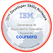
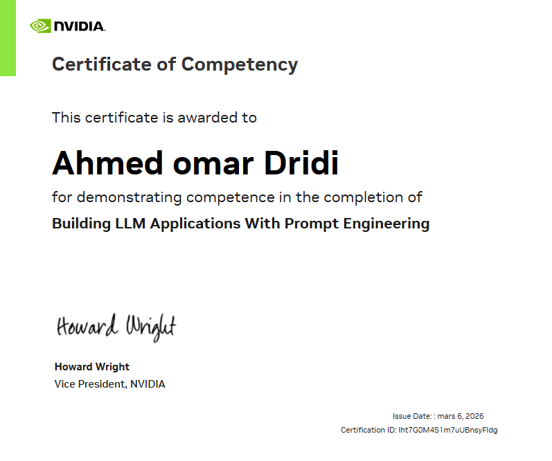
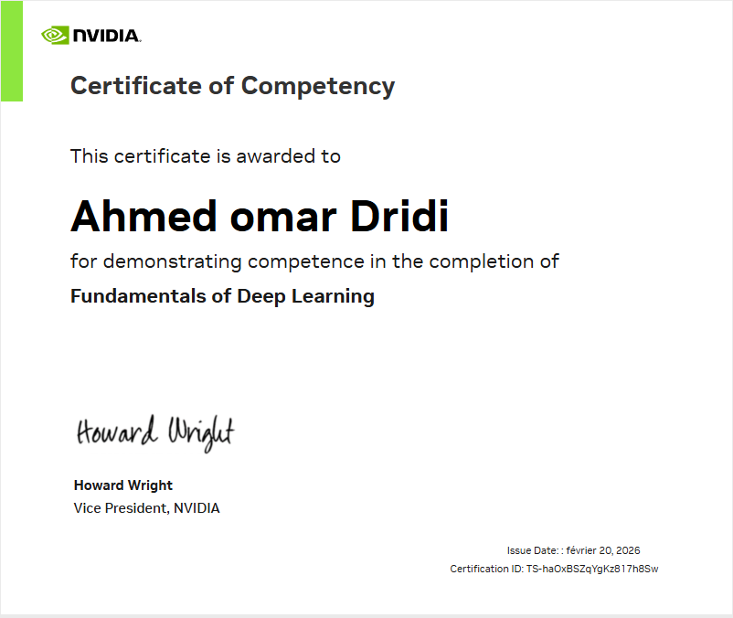
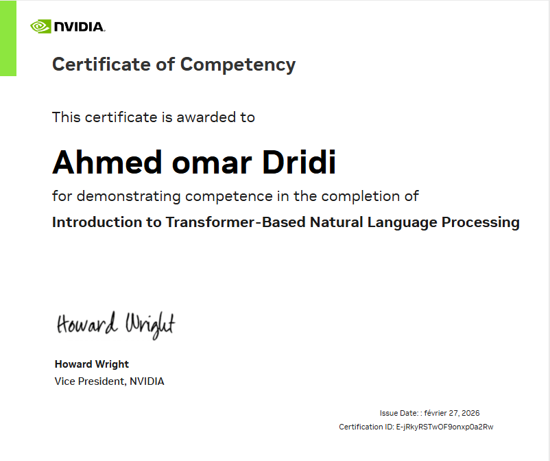
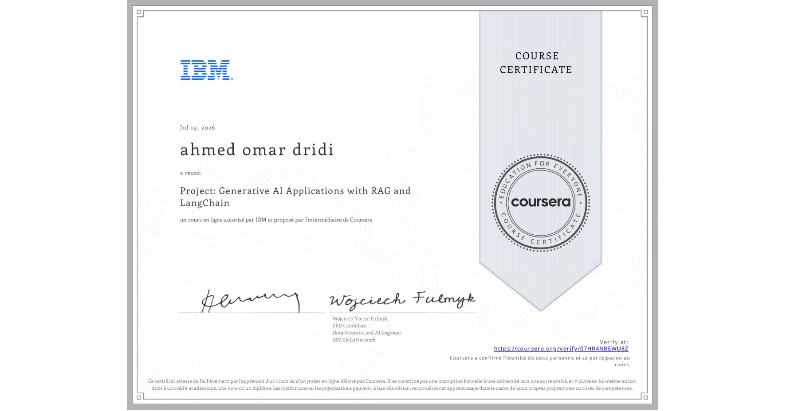
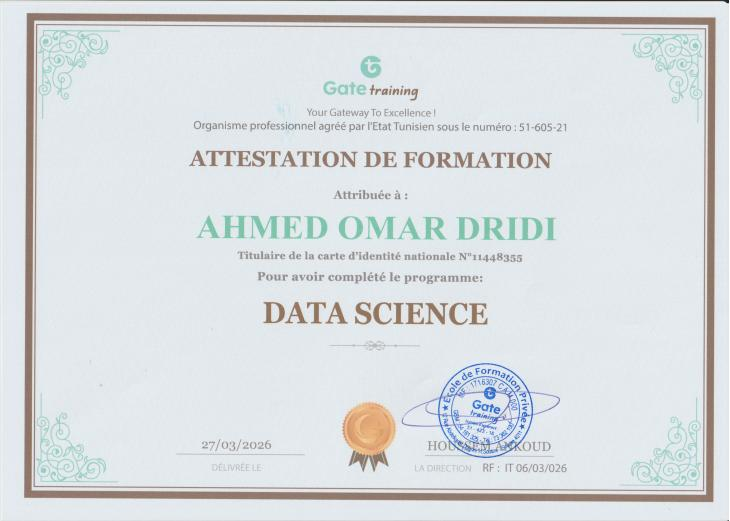
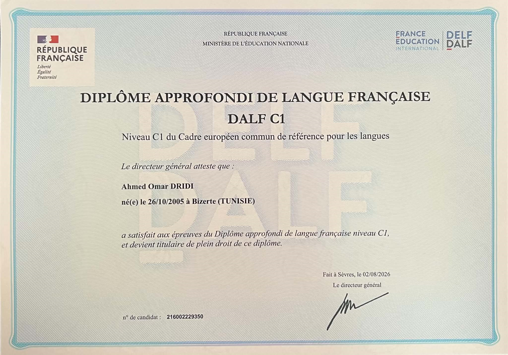

<h1 align="center">Ahmed Omar Dridi</h1>

<h3 align="center">
AI & Full-Stack Engineer | Engineering Student @ ESPRIT
</h3>

🌐 <b><a href="https://dridi10331.github.io/protfolio/">View my full portfolio →</a></b>

---

# 👋 About Me

3rd-year Engineering Student at **ESPRIT** (Tunis) building scalable AI systems that solve real-world problems.

| Area | What I do |
|---|---|
| 🤖 **AI / ML** | Computer vision, LLMs, RAG, document intelligence |
| ⚡ **Backend** | FastAPI, NestJS, PostgreSQL, API design |
| 🌐 **Full-Stack** | Next.js, TypeScript, Stripe, multi-tenant apps |
| 🐳 **Deployment** | Docker, RunPod, vLLM, system design |

---

# 🚀 Tech Stack

---

# 📂 Featured Projects

| Project | What it does | Stack |
|---|---|---|
| 🛍️ **ShopVision** | Real-time visual product search (68% mAP) | YOLOv12s • FastAPI • PostgreSQL • Supabase • Streamlit |
| 🚗 **Car Damage Detection** | Detects and classifies vehicle damage from images | YOLOv8 • OpenCV • PyTorch |
| 📄 **OCR Document Chatbot** | Chat with scanned documents | LangChain • FastAPI • FAISS • Groq |
| 💼 **CV Job Matching** | Matches CVs to job offers | NLP • Transformers • Python |
| 🤖 **AI Code Review Agent** | Automated PR review with LLMs | LLMs • FastAPI • GitHub |

> 🌐 More details and demos on my [portfolio](https://dridi10331.github.io/protfolio/).

---

# 💼 Experience

### Full Stack & AI Developer Intern — Bit&Books Inc.
*Jun 2026 – Aug 2026 · 3 months · Remote*

- Built full-stack features for **BitCart**, a multi-tenant e-commerce platform (Next.js, NestJS, Prisma, Stripe): checkout, guest cart, dashboards, tenant isolation, multi-store
- Designed an end-to-end document pipeline: **OCR → classification → extraction → accounting automation**
- Re-engineered OCR with **PaddleOCR-VL** and remote LLM inference via **vLLM + RunPod**
- Rule-based classifier for 7 document types: **74.3% overall accuracy, 98.9% on receipts** (7,831 documents)
- Bookkeeping rule engine producing balanced double-entry journals with Canadian GST/HST/QST/PST handling; API deployed on RunPod

**Tech:** Python, FastAPI, Next.js, NestJS, TypeScript, PostgreSQL, Prisma, Firebase, Stripe, Docker, PaddleOCR-VL, vLLM, LLMs, RunPod

### Data Analyst Intern — Unfrauded
*2 months*

- Processed **10,000+ insurance claims** and built fraud detection workflows
- Optimized SQLite queries to **sub-50 ms**
- Built dashboards with Apache Superset

### Computer Vision / ML Engineering Intern — ITGate
*1 month*

- Built a real-time visual search system
- Reduced inference latency by **40%** and false positives by **65%**
- Designed the PostgreSQL/Supabase backend and optimized the production inference pipeline

---

# 🏆 Certifications & Badges

| Certificate / Badge | Issuer | Link |
|---|---|---|
| Generative AI Applications Specialist | IBM | [Credly](https://www.credly.com/badges/c5e9a1d6-0dd4-4565-8854-ed321bdbabd4/public_url) |
| Building RAG Applications Using MongoDB | MongoDB | [Credly](https://www.credly.com/badges/53d13d67-c755-4ca3-af08-2a9dccbad26f/public_url) |
| RAG with LangChain — Guided Project | IBM / Coursera | [Certificate](https://github.com/dridi10331/dridi10331/blob/main/CERTIFICATE_LANDING_PAGE~07HR4NBEWU8Z.jpeg) |
| Building LLM Applications With Prompt Engineering | NVIDIA DLI | [Certificate](https://github.com/dridi10331/dridi10331/blob/main/Building%20LLM%20Applications%20With%20Prompt%20Engineering.png) |
| Fundamentals of Deep Learning | NVIDIA DLI | [Certificate](https://github.com/dridi10331/dridi10331/blob/main/Fundamentals%20of%20Deep%20Learning.png) |
| Introduction to Transformer-Based NLP | NVIDIA DLI | [Certificate](https://github.com/dridi10331/dridi10331/blob/main/Introduction%20to%20Transformer-Based%20Natural%20Language%20Processing.png) |
| AI/Software Engineering Bootcamp | JobGate | [Certificate](https://github.com/dridi10331/dridi10331/blob/main/1779985610925.jpg) |
| Introduction to Git | — | [Badge](https://github.com/dridi10331/dridi10331/blob/main/introduction-to-git-badge.svg) |

&nbsp;&nbsp;

&nbsp;&nbsp;

&nbsp;&nbsp;

&nbsp;&nbsp;

&nbsp;&nbsp;

---

# 🌍 Languages

| Language | Level |
|---|---|
| 🇹🇳 **Arabic** | Native |
| 🇫🇷 **French** | DALF C1 certified |
| 🇬🇧 **English** | Professional working proficiency — daily use in AI engineering, backend development and documentation |

---

# 📫 Connect With Me

<a href="https://dridi10331.github.io/protfolio/">Portfolio</a> •
<a href="https://www.linkedin.com/in/ahmedomardridi">LinkedIn</a> •
<a href="mailto:ahmedomardridi5@gmail.com">Email</a> •
<a href="https://huggingface.co/ahmedomar10">Hugging Face</a>

---

⭐ If you find my projects useful, consider giving them a star!

